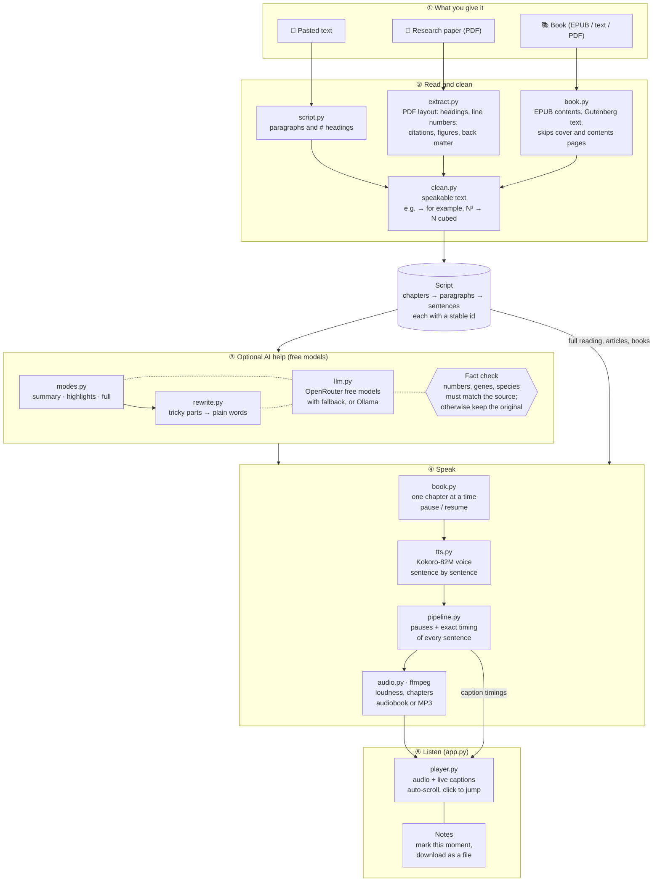

# Tex2vois

**Listen to articles, research papers and books in a natural voice, and follow along with live captions.
Speech runs on your own computer; the optional AI parts use free models.**

Most "PDF to speech" tools read everything on the page: running headers, page numbers, `[12]`-style citations,
author emails, figure labels, table cells. Tex2vois treats it as a pipeline problem: understand the page layout,
keep only what a human narrator would read, optionally let a local LLM make it speakable, then synthesise it
with a small, high-quality neural voice and package it as an audiobook with chapters.

## Architecture



**How a request flows:** every input becomes the same `Script` (chapters of paragraphs). For papers, `modes.py`
can turn it into a summary or highlights; anything an AI model writes is fact-checked, and if a check fails the
original wording is used instead. `pipeline.speak` then synthesises one sentence at a time, recording exactly
when each sentence starts and ends, which is what drives the live captions. Books go through the same path one
chapter at a time, with a manifest on disk so generation can pause and resume.

| Module | Job |
|---|---|
| `extract.py` | PDF → sections (outline, run-in and ALL-CAPS headings, margin line numbers, superscript citations, figures, back matter) |
| `clean.py` | Rule-based cleanup so text reads well aloud |
| `script.py` | The `Script` / `Chapter` / `Para` model; pasted-text loader |
| `book.py` | EPUB and plain-text books; resumable chapter-by-chapter generation; final audiobook assembly |
| `modes.py` | Paper summary, highlights (skim) and full reading |
| `llm.py` | One client for OpenRouter free models (with fallback) or local Ollama; reads `.env` |
| `rewrite.py` | Optional AI rewrite with length and fact guards |
| `tts.py` | Kokoro-82M voices, sentence splitting |
| `pipeline.py` | Load → mode → rewrite → speech; timings, captions and cues |
| `audio.py` | ffmpeg export: loudness normalisation, chapter markers, m4b / mp3 / wav |
| `player.py` | Now-playing card with custom controls, synced captions and the notes pad |
| `themes.py` | Colour themes, background patterns and the background-picture option |
| `triage.py` | Instructions for Claude / ChatGPT: the read-in-depth verdict and listening scripts of a chosen length |
| `assistant.py` | Reads a script written by Claude / ChatGPT and checks it against the paper |
| `app.py` | The web app (Gradio): Article, Paper and Book tabs |

## Three ways to listen

| | Input | What you get | AI needed? |
|---|---|---|---|
| **Article** | pasted text | the whole text, read naturally | no |
| **Research paper** | PDF | **Summary** (~2 min) → **Skim** (key parts, ~⅙–⅓) → **Full** reading | summary/skim: yes (free); full: no |
| **Book** | EPUB, plain text (e.g. Project Gutenberg) or PDF | chapter-by-chapter audiobook; listen while the rest is prepared; pause and resume | no |

**Should I read this in depth?** The Research paper tab also prepares ready-to-paste instructions for Claude or
ChatGPT (your own account; Tex2vois sends nothing). They ask for a fixed format: takeaway, what was done, key
findings with exact numbers, strength of evidence, limitations, relevance to what you're looking for, and a verdict
(read in depth / skim the figures and discussion / skip). Copy them alone and attach the PDF, or copy them together
with the paper's cleaned text and just paste.

**Assistant script.** A separate tab for listening to a paper explained by your own Claude or ChatGPT:
choose a length (about 5, 10 or 20 minutes, or everything), copy the instructions (optionally with the paper's text),
let the assistant write the script, paste it back, and listen. Tex2vois tidies the reply (chatter, bullets, tables,
"continuing" markers), warns if the script stopped early, and, if the paper is added, reports how many of the paper's
numbers and names made it into the script and lists any that aren't in the paper.

**About your work** is an optional note (for example "I study RNAi-based pest control in soybean") that is added to
the instructions so the assistant can judge relevance. It is remembered in your browser only, and a "Use it this time"
switch leaves it out for a single paper.

**Look and feel.** A now-playing card with play, back and forward 15 seconds, a seekable progress bar and
playback speed; captions dim everything except the paragraph being read. Pick a colour theme in the header
(Classic, or palettes inspired by Naruto, Demon Slayer, One Piece, Solo Leveling and Hunter x Hunter; colours and
original CSS patterns only, no artwork), each with light and dark versions checked for contrast. You can also set
your own background picture: it is resized and kept in your browser only, never uploaded. Each anime theme also has
an original illustrated scene (drawn in SVG, no copied art); to use your own picture for a theme on your computer,
put it in `local_art/` as `naruto.jpg`, `one-piece.jpg` and so on. That folder is git-ignored, so it is never published. Animations are gentle and
switch off when your device asks for reduced motion.

While listening, the words light up as they are read and the caption box scrolls with the audio (click a
sentence to jump there). A notes pad sits next to the player: **Mark this moment** adds the time and the
sentence being read, and the download button saves your notes as a text file.

Every paragraph has a stable id, and each skim paragraph records which full-text paragraph it came from;
a `.cues.json` file next to the audio gives each paragraph's start time, so a player can jump from the
skim straight into the full reading at the same point.

## Features

- **Layout-aware extraction.** Drops repeated headers/footers and page numbers, author blocks above the
  abstract, footnotes (by font size), rotated margin text (e.g. arXiv stamps), text inside or hugging
  figures, figure/table captions, and everything after *References*. Re-joins words hyphenated across lines
  while keeping real compounds (`English-to-German`).
- **Chapters.** Taken from the PDF outline when present (matched against bold/large lines so figure labels
  can't fake a heading), else detected by font size. Exported as real chapter markers in `.m4b`.
- **Speakable text.** Removes numeric and author-year citations, URLs and emails; expands `e.g.`, `i.e.`,
  `Fig. 3`, `vs.` and friends.
- **Free AI, fact-checked.** Summaries, methods recaps and the optional "rewrite for listening" pass use free
  OpenRouter models (falling back through a list when one is rate-limited) or a local Ollama model. Two guards:
  a **length guard** (rewrite must stay within 0.6–1.6× the original) and a **fact guard** — every number,
  gene/protein-style name (`HhCHC`, `dsRNA-CHC`, `AtMYB75`) and abbreviated species (`A. thaliana`) must survive a
  rewrite, and a summary may not mention any number or name that is not in the paper. Anything that fails falls
  back to the paper's own words (e.g. the abstract), and the app says so.
- **Research-paper layouts.** Run-in headings ("1. Introduction. Life is…"), ALL-CAPS headings, bioRxiv margin line
  numbers, superscript citation markers (exponents like N³ are kept and read as "N cubed"), and back matter
  (acknowledgements, funding, author contributions, conflicts of interest) are all handled.
- **Kokoro-82M** voices (Apache-2.0), 9 curated US/UK voices, adjustable speed.
- **Audiobook output.** Loudness-normalised (−18 LUFS) M4B with chapters, MP3, or WAV; natural pauses between
  sentences, paragraphs and chapters.
- **CLI and web UI** (Gradio), with a "what was read aloud" view of the exact script.

## Benchmarks

MacBook Air M4, 16 GB, *Attention Is All You Need* (15 pages):

| Stage | Result |
|---|---|
| Extraction + cleanup | 0.4 s → 22 chapters, 4,678 words |
| Speech synthesis (Kokoro, CPU) | 248 s for 43 min of audio → **RTF 0.10 (≈10× faster than real time)** |
| Output | 21 MB M4B, mean −18.9 dB, only gaps > 2 s are the 22 chapter breaks |

**CPU vs Apple GPU for Kokoro-82M** (warm, same 36 s passage):

| Device | Synthesis time | RTF |
|---|---|---|
| CPU | 3.7 s | **0.10** |
| MPS (Apple GPU) | 6.0 s | 0.17 |

For a model this small, kernel-launch overhead outweighs the GPU's throughput, so Tex2vois defaults to CPU.

## Quickstart (macOS, Apple Silicon)

```bash
brew install ffmpeg espeak-ng
git clone https://github.com/bbijjam/Tex2vois.git && cd Tex2vois
uv venv --python 3.11 && uv pip install -e '.[dev]'     # or: python3.11 -m venv .venv && pip install -e '.[dev]'
source .venv/bin/activate
```

The Kokoro weights (~330 MB) download from Hugging Face on first run.

**Web UI**

```bash
python app.py        # http://127.0.0.1:7860
```

**CLI**

```bash
tex2vois paper.pdf                          # -> paper.m4b with chapters
tex2vois paper.pdf -o paper.mp3 -v bm_george -s 1.1
tex2vois paper.pdf --pages 5 --script       # print exactly what would be read, no audio
tex2vois --list-voices
tex2vois novel.epub                         # audiobook, chapter by chapter (Ctrl+C, rerun to resume)
tex2vois novel.epub --chapters 1-3          # just the first three chapters
```

**AI features (summary, skim, rewrite)**

Option A — free cloud models via [OpenRouter](https://openrouter.ai) (no cost; free models are rate-limited):

```bash
cp .env.example .env            # then put your key in .env:  OPENROUTER_API_KEY=sk-or-v1-...
```

Only `:free` models are used unless you set `TEX2VOIS_ALLOW_PAID=1`. Override the model list with
`TEX2VOIS_MODELS="model-a:free,model-b:free"` (the free catalogue changes often).

Option B — fully local with [Ollama](https://ollama.com):

```bash
ollama pull qwen2.5:7b          # 16 GB RAM; use llama3.2:3b on 8 GB machines
export TEX2VOIS_LLM=ollama
```

```bash
tex2vois paper.pdf --mode summary           # ~2 minute spoken summary
tex2vois paper.pdf --mode skim --script     # print the skim, no audio
tex2vois paper.pdf --rewrite                # full reading, smoothed for listening (slow)
tex2vois paper.pdf --mode skim --no-llm     # skim from the paper's own words only
pbpaste | tex2vois - -o article.mp3         # an article from the clipboard
```

## Tests

```bash
pytest                                   # fast unit tests
TEX2VOIS_E2E=1 pytest tests/e2e -q       # browser tests (once: playwright install chromium)
```

The browser tests start their own copy of the app with AI switched off (`TEX2VOIS_LLM=off`) and check, in light and
dark mode and several themes, that every dropdown opens next to its box with every option clickable, no button is
covered, all four tabs fit on a phone, the player controls, Stop, notes, themes and background picture work, and each
tab's full flow (article, paper modes, assistant script, book) produces audio with captions.

## Roadmap

- [ ] OCR for scanned PDFs (Tesseract / Docling)
- [ ] TTS model shoot-out: Kokoro vs Piper vs Chatterbox (RTF + listening test)
- [ ] Ablation: raw vs rule-cleaned vs LLM-rewritten text (Whisper WER + listener ratings)
- [ ] Word-level highlighting in the UI via Whisper alignment
- [ ] MLX backend for Apple Silicon
- [ ] Docker image + Hugging Face Space demo
- [x] Book mode: EPUB / text input, chapter-by-chapter generation that can pause and resume
- [x] Live captions and a notes pad
- [ ] Switch between highlights and the full reading at the same paragraph (uses `.cues.json`)
- [ ] "Paste a DOI": fetch open full-text XML from Europe PMC / bioRxiv before falling back to the PDF
- [ ] Pronunciation lexicon for species, genes and reagents (plant and molecular biology first)

## License

MIT. Kokoro-82M weights are Apache-2.0.
