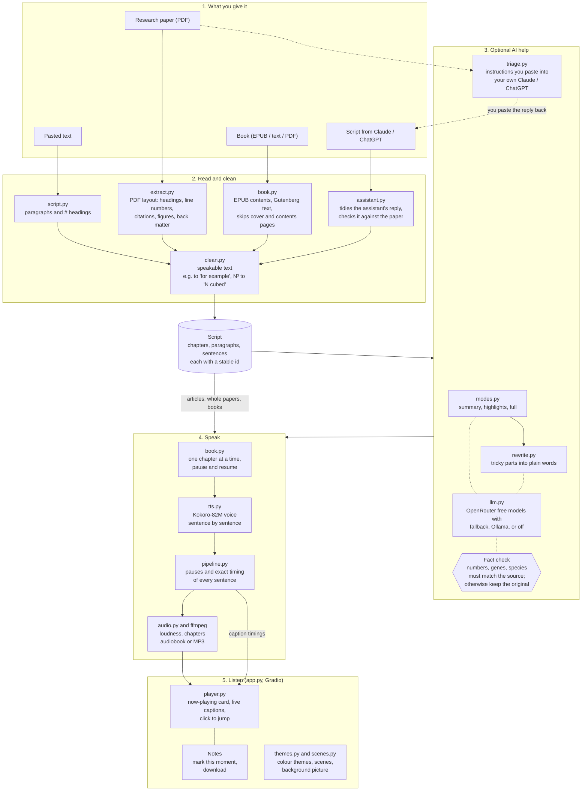

# Tex2vois

**Listen to articles, research papers and books in a natural voice, and follow every word with live captions.**
The voice runs on your own computer. The optional AI parts use free models, or your own Claude / ChatGPT account.

Most "PDF to speech" tools read everything on the page: running headers, page numbers, `[12]`-style citations,
author emails, figure labels and table cells. Tex2vois understands the page layout, keeps only what a human
narrator would read, and turns it into an audiobook with chapters, live captions and a notes pad.

## Quick start

**macOS or Linux, one command** (clones the repo, installs everything, and opens the app in your browser):

```bash
git clone https://github.com/bbijjam/Tex2vois.git && cd Tex2vois && ./setup.sh && ./run.sh
```

The first setup downloads about 1.5 GB (the voice model and its libraries) and takes 5 to 15 minutes depending on
your connection. After that, start the app any time with `./run.sh` from the `Tex2vois` folder and open
**http://127.0.0.1:7860**. Press `Ctrl+C` in the terminal to stop it.

What `setup.sh` does: installs `ffmpeg` and `espeak-ng` (with Homebrew on macOS, or tells you the `apt` command on
Linux), installs [uv](https://docs.astral.sh/uv/) if needed, and creates a Python 3.11 environment in `.venv/`.
Nothing is installed system-wide except those two tools and uv. On Windows, use WSL (Ubuntu) and run the same command.

## What you can do

| Tab | Give it | You get | AI needed? |
|---|---|---|---|
| **Article** | pasted text | the whole text read aloud | no |
| **Research paper** | a PDF | a **quick summary** (about 2 minutes), the **highlights**, or **the whole paper** | summary and highlights: optional, free |
| **Assistant script** | a script written by your Claude or ChatGPT | a listen of the length you chose (5, 10, 20 minutes or everything) | your own assistant |
| **Book** | EPUB, plain text (e.g. Project Gutenberg) or PDF | an audiobook made chapter by chapter; listen while the rest is prepared; pause and resume | no |

**While listening**
- A now-playing card with play and pause, back and forward 15 seconds, a progress bar you can click or drag,
  playback speed (0.75x to 2x) and the current chapter.
- Live captions: the sentence being read is highlighted and the caption box scrolls with the audio. Click any
  sentence to jump there.
- A notes pad: **Mark this moment** adds the time and the sentence being read; the download button saves your notes
  as a text file. Notes are kept in your browser.

**Should I read this paper in depth?** The Research paper tab prepares ready-to-paste instructions for Claude or
ChatGPT, with buttons to copy them (optionally with the paper's text) and links to open either assistant. They ask
for a fixed answer: takeaway, what was done, key findings with exact numbers, strength of evidence, limitations,
relevance to you, and a verdict (read in depth, skim, or skip). Tex2vois sends nothing anywhere; you paste it yourself.

**Assistant script.** Copy the "write a listening script" instructions, choose a length, let your assistant write
the script, paste it back and press **Read it to me**. Tex2vois removes the assistant's chatter, bullets and tables,
warns if the script stopped early, and, if you added the paper, reports how many of the paper's numbers and names
made it into the script and lists any that are not in the paper.

**About your work** is an optional note (for example "I study RNAi-based pest control in soybean") added to both
kinds of instructions so the assistant can judge relevance. It is remembered in your browser, with a
"Use it this time" switch to leave it out for one paper.

**Look and feel**
- Colour themes in the header: Classic, plus palettes inspired by Naruto, Demon Slayer, One Piece, Solo Leveling and
  Hunter x Hunter. Each has an original illustrated background scene (drawn in SVG, no copied artwork) and light and
  dark versions checked for readable contrast.
- **Background picture**: use any image from your computer as the background. It is resized and kept in your browser
  only, never uploaded.
- Your own picture per theme: put it in `local_art/` as `naruto.jpg`, `demon-slayer.jpg`, `one-piece.jpg`,
  `solo-leveling.jpg` or `hunter-x-hunter.jpg` and restart. The folder is git-ignored, so it is never published.
- Gentle animations (fade-ins, an equalizer while playing, a shimmer while preparing, button lift and ripple), all
  switched off when your device asks for reduced motion. Works on phones too.
- Plain language throughout: no file-format or AI jargon in the interface.

## Architecture



**How a request flows.** Every input becomes the same `Script` (chapters of paragraphs). For papers, `modes.py` can
turn it into a summary or highlights; anything an AI model writes is fact-checked, and if a check fails the
original wording is used instead (the app tells you). `pipeline.speak` then voices one sentence at a time and records
exactly when each sentence starts and ends, which drives the live captions. Books go through the same path one
chapter at a time, with a manifest on disk so preparation can pause and resume. The Claude / ChatGPT features never
call those services: Tex2vois prepares instructions, you paste them, and you paste the answer back.

| Module | Job |
|---|---|
| `extract.py` | PDF to sections: outline, run-in and ALL-CAPS headings, margin line numbers, superscript citations, figures, captions, back matter |
| `clean.py` | Rule-based cleanup so text reads well aloud |
| `script.py` | The `Script` / `Chapter` / `Para` model; pasted-text loader |
| `book.py` | EPUB and plain-text books; resumable chapter-by-chapter generation; final audiobook assembly |
| `modes.py` | Paper summary, highlights and whole-paper reading |
| `llm.py` | One client for OpenRouter free models (with fallback), local Ollama, or off; reads `.env` |
| `rewrite.py` | Optional AI rewrite with length and fact guards |
| `triage.py` | Instructions for Claude / ChatGPT: the read-in-depth verdict and listening scripts of a chosen length |
| `assistant.py` | Reads a script written by Claude / ChatGPT and checks it against the paper |
| `tts.py` | Kokoro-82M voices, sentence splitting |
| `pipeline.py` | Load, mode, rewrite, speech; timings, captions and cues |
| `audio.py` | ffmpeg export: loudness normalisation, chapter markers, m4b / mp3 / wav |
| `player.py` | Now-playing card with custom controls, synced captions and the notes pad |
| `themes.py` | Colour themes, background patterns and the background-picture option |
| `scenes.py` | Original illustrated SVG scene per theme, or your own picture from `local_art/` |
| `app.py` | The web app (Gradio): Article, Research paper, Assistant script and Book tabs |

## How the text is made listenable

- **Layout-aware extraction.** Drops repeated headers and footers, page numbers, author blocks above the abstract,
  footnotes (by font size), rotated margin text (e.g. arXiv stamps), text inside or next to figures, figure and table
  captions, and everything after *References*. Re-joins words hyphenated across lines while keeping real compounds
  (`English-to-German`).
- **Research-paper layouts.** Run-in headings ("1. Introduction. Life is..."), ALL-CAPS headings, bioRxiv margin line
  numbers, superscript citation markers (exponents like N³ are kept and read as "N cubed"), and back matter
  (acknowledgements, funding, author contributions, conflicts of interest).
- **Chapters** from the PDF outline when present (matched against bold or large lines, so figure labels can't fake
  a heading), otherwise from font size and standard section names. Exported as real chapter markers.
- **Speakable text.** Removes numeric and author-year citations, URLs and emails; expands `e.g.`, `i.e.`, `Fig. 3`,
  `vs.` and friends.
- **Free AI, fact-checked.** Summaries, the methods recap and the optional "make tricky parts easier to hear" pass
  use free OpenRouter models (trying the next one when a model is busy) or a local Ollama model. A **length guard**
  keeps rewrites within 0.6 to 1.6 times the original, and a **fact guard** requires every number, gene or
  protein-style name (`HhCHC`, `dsRNA-CHC`, `AtMYB75`) and abbreviated species (`A. thaliana`) to survive; a summary
  may not mention any number or name that is not in the paper. Anything that fails falls back to the paper's own words.
- **Voice**: Kokoro-82M (Apache-2.0), nine US and UK voices, adjustable speed. Loudness-normalised output with
  natural pauses between sentences, paragraphs and chapters.

## Benchmarks

MacBook Air M4, 16 GB, *Attention Is All You Need* (15 pages):

| Stage | Result |
|---|---|
| Extraction and cleanup | 0.4 s, 22 chapters, 4,678 words |
| Speech (Kokoro, CPU) | 248 s for 43 min of audio, **about 10 times faster than real time** |
| Output | 21 MB audiobook, only gaps over 2 s are the 22 chapter breaks |

Kokoro-82M on CPU vs Apple GPU (same 36 s passage): CPU 3.7 s, GPU 6.0 s. For a model this small the GPU's overhead
outweighs its speed, so Tex2vois uses the CPU.

## Optional: AI features

Without any setup, the quick summary falls back to the paper's abstract and the highlights use the paper's own words.
For AI-written summaries:

- **Free cloud models** via [OpenRouter](https://openrouter.ai): `cp .env.example .env`, then put your key in `.env`
  as `OPENROUTER_API_KEY=sk-or-v1-...`. Only `:free` models are used unless you set `TEX2VOIS_ALLOW_PAID=1`; change
  the list with `TEX2VOIS_MODELS="model-a:free,model-b:free"`. `.env` is git-ignored.
- **Fully local** with [Ollama](https://ollama.com): `ollama pull qwen2.5:7b` (16 GB RAM; `llama3.2:3b` on 8 GB),
  then `export TEX2VOIS_LLM=ollama`.
- **Off**: `export TEX2VOIS_LLM=off`.

## Command line

```bash
source .venv/bin/activate
tex2vois paper.pdf                          # the whole paper as an audiobook (paper.m4b)
tex2vois paper.pdf --mode summary           # about 2 minutes
tex2vois paper.pdf --mode skim --script     # print the highlights, no audio
tex2vois paper.pdf -o paper.mp3 -v bm_george -s 1.1
tex2vois novel.epub --chapters 1-3          # a book, chapter by chapter (Ctrl+C, rerun to resume)
pbpaste | tex2vois - -o article.mp3         # an article from the clipboard (macOS)
tex2vois --list-voices
```

## Tests

```bash
source .venv/bin/activate
uv pip install -e '.[dev]' && playwright install chromium     # once
pytest                                                         # unit tests
TEX2VOIS_E2E=1 pytest tests/e2e -q                             # browser tests
```

The browser tests start their own copy of the app with AI switched off and check, in light and dark mode and
several themes: every dropdown opens next to its box with every option clickable, no button is covered, all four
tabs fit on a phone, the player controls, Stop, notes, themes and background picture work, and each tab's full flow
(article, the three paper modes, assistant script, book) produces audio with captions.

## Roadmap

- [x] Article, research paper (summary, highlights, whole) and book modes
- [x] Live captions, notes pad, now-playing player
- [x] Instructions for Claude / ChatGPT: read-in-depth verdict and listening scripts
- [x] Colour themes, illustrated scenes, background picture, animations
- [x] Browser test suite
- [ ] Switch between highlights and the whole paper at the same paragraph (data is in `.cues.json`)
- [ ] "Paste a DOI": fetch open full text from Europe PMC / bioRxiv before falling back to the PDF
- [ ] Pronunciation list for species, genes and reagents (plant and molecular biology first)
- [ ] OCR for scanned PDFs
- [ ] Hosted demo (Hugging Face Space)

## License

MIT. Kokoro-82M weights are Apache-2.0.
